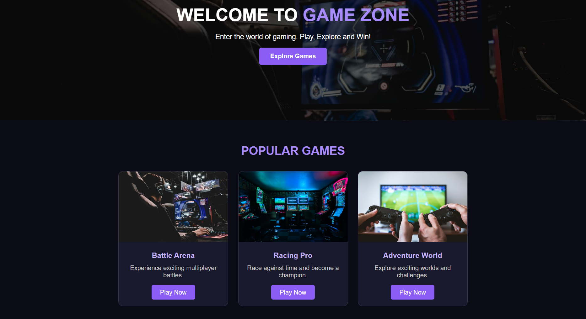

# Ex02 – Commercial Website Using CSS Flexbox
# Date:
03-11-2026
# AIM
To create a commercial gaming website using HTML and CSS Flexbox with navigation bar, homepage, game products, about us, contact details and footer.
# ALGORITHM
# STEP 1
Create an HTML file (index.html).
# STEP 2
Create a CSS file (style.css).
# STEP 3
Include a navigation bar with links to Home, Games, About and Contact sections.
# STEP 4
Create a homepage with a gaming background image, heading and Explore Games button.
# STEP 5
Add a Games section displaying different games with images, descriptions and Play Now buttons.
# STEP 6
Create an About Us section describing the gaming website.
# STEP 7
Add a Contact section with email and phone number.
# STEP 8
Use CSS Flexbox to arrange the navigation bar and game cards.
# STEP 9
Apply background colors, fonts, spacing and borders using CSS.
# STEP 10
Add hover effects and transitions to game cards and buttons.
# STEP 11
Make the website responsive for different screen sizes.
# STEP 12
Add a footer with copyright information.
# STEP 13
Open the HTML file in a web browser.
# STEP 14
Check the website layout and functionality and correct any errors.
STEP 15
Upload the website files to GitHub and deploy using GitHub Pages.
# PROGRAM
# HTML Code 
```
<!DOCTYPE html>
<html>
<head>
    <title>Game Zone</title>
    <link rel="stylesheet" href="style.css">
</head>
<body>

<header>
    <h2>GAME ZONE</h2>
    <nav>
        <a href="#home">Home</a>
        <a href="#games">Games</a>
        <a href="#about">About</a>
        <a href="#contact">Contact</a>
    </nav>
</header>

<section class="home" id="home">
    <h1>Welcome to Game Zone</h1>
    <p>Play, Explore and Win!</p>
    <a href="#games" class="btn">Explore Games</a>
</section>

<section class="games" id="games">
    <h2>Popular Games</h2>

    <div class="game-container">
        <div class="card">
            
            <h3>Battle Arena</h3>
            <p>Experience exciting battles.</p>
            <button>Play Now</button>
        </div>

        <div class="card">
            
            <h3>Racing Pro</h3>
            <p>Become a racing champion.</p>
            <button>Play Now</button>
        </div>

        <div class="card">
            
            <h3>Adventure World</h3>
            <p>Explore new adventures.</p>
            <button>Play Now</button>
        </div>
    </div>
</section>

<section class="about" id="about">
    <h2>About Us</h2>
    <p>Game Zone is a platform for gaming lovers.
       Discover exciting games and enjoy a wonderful
       gaming experience.</p>
</section>

<section class="contact" id="contact">
    <h2>Contact Us</h2>
    <p>Email: gamezone@gmail.com</p>
    <p>Phone: +91 9876543210</p>
</section>

<footer>
    <p>© 2026 Game Zone | All Rights Reserved</p>
</footer>

</body>
</html>

```
# CSS Code 
```
* {
    margin: 0;
    padding: 0;
    box-sizing: border-box;
    font-family: Arial, sans-serif;
}

body {
    background: #0b0b16;
    color: white;
}

/* Header */
header {
    background: #151526;
    padding: 20px 8%;
    display: flex;
    justify-content: space-between;
    align-items: center;
}

header h2 {
    color: #a78bfa;
}

nav {
    display: flex;
    gap: 25px;
}

nav a {
    color: white;
    text-decoration: none;
}

nav a:hover {
    color: #a78bfa;
}

/* Home */
.home {
    height: 400px;
    background: linear-gradient(
        rgba(0,0,0,0.6),
        rgba(0,0,0,0.6)
    ), url("https://images.unsplash.com/photo-1542751371-adc38448a05e?w=1200");
    background-size: cover;
    background-position: center;
    display: flex;
    flex-direction: column;
    justify-content: center;
    align-items: center;
    gap: 20px;
}

.home h1 {
    font-size: 40px;
    color: #a78bfa;
}

.btn, button {
    background: #8b5cf6;
    color: white;
    padding: 12px 25px;
    border: none;
    text-decoration: none;
    border-radius: 5px;
    cursor: pointer;
}

/* Games */
.games {
    padding: 50px 8%;
    text-align: center;
}

.games h2, .about h2, .contact h2 {
    color: #a78bfa;
    margin-bottom: 30px;
}

.game-container {
    display: flex;
    justify-content: center;
    gap: 25px;
    flex-wrap: wrap;
}

.card {
    background: #19192d;
    width: 280px;
    padding-bottom: 25px;
    border-radius: 10px;
    overflow: hidden;
    transition: 0.3s;
}

.card:hover {
    transform: translateY(-10px);
    box-shadow: 0 5px 20px #8b5cf6;
}

.card img {
    width: 100%;
    height: 170px;
    object-fit: cover;
}

.card h3 {
    margin: 15px;
}

.card p {
    margin-bottom: 20px;
}

/* About */
.about {
    background: #151526;
    padding: 50px;
    text-align: center;
}

.about p {
    line-height: 1.8;
}

/* Contact */
.contact {
    padding: 50px;
    text-align: center;
}

.contact p {
    margin: 10px;
}

/* Footer */
footer {
    background: #151526;
    padding: 20px;
    text-align: center;
}

/* Responsive */
@media (max-width: 600px) {
    header {
        flex-direction: column;
        gap: 20px;
    }

    nav {
        gap: 12px;
    }

    .home h1 {
        font-size: 28px;
        text-align: center;
    }
}
```

# OUTPUT

# RESULT
Thus, the commercial gaming website using HTML and CSS Flexbox was created and executed successfully.